# Architecture: the layers and what crosses them

This document is the current map of the workspace's abstraction layers:
which crate owns which concept, every call that crosses a crate boundary,
and the internal call flow of the multiplexer. It is the reference for
checking that a change does not leak a concept into a layer that should
not know it, and that no two APIs cover the same concern.

Decisions behind this shape: ADR 0002 (transport and mux), 0003 (tunnel
protocol), 0004 (stream policy and messages), 0005 (minimal mux surface),
0008 (flat hostnames and the wildcard certificate), 0010 (one key per
machine), 0011 (the client dials the admin host only).

## 1. Layer map

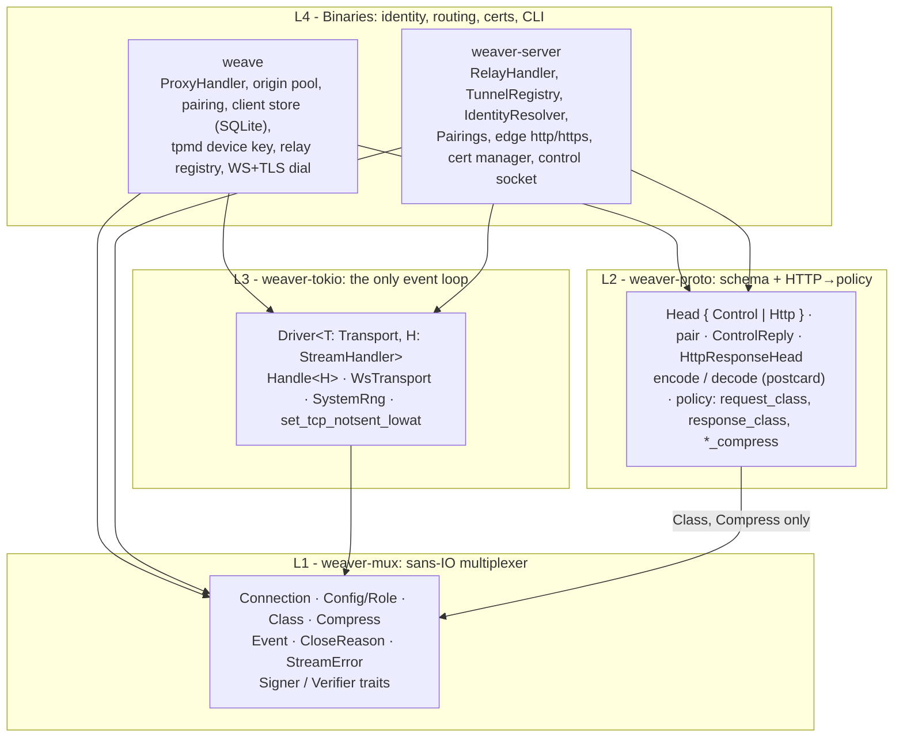

| Layer | Knows | Does not know |
|---|---|---|
| `weaver-mux` | classes, per-message compression stance, credit, frames, `KeyId` | MIME, HTTP, hostnames, identities, schemas, sockets, clocks |
| `weaver-proto` | HTTP/control schemas, HTTP → `Class`/`Compress` rules, proto version | sockets, tokio, who a key is |
| `weaver-tokio` | how to pump a `Connection` over a `Sink + Stream` | schemas, policy rules |
| binaries | identity, pairing and the device key, routing, certs, CLI | frame layout, scheduler |

The graph is acyclic and each crate depends only on layers below it.

## 2. `weaver-mux`

### 2.1 Public surface

Everything an application can name, in one place (`lib.rs`). `wire` is
public only so tests and fuzz targets can hand-craft frames.

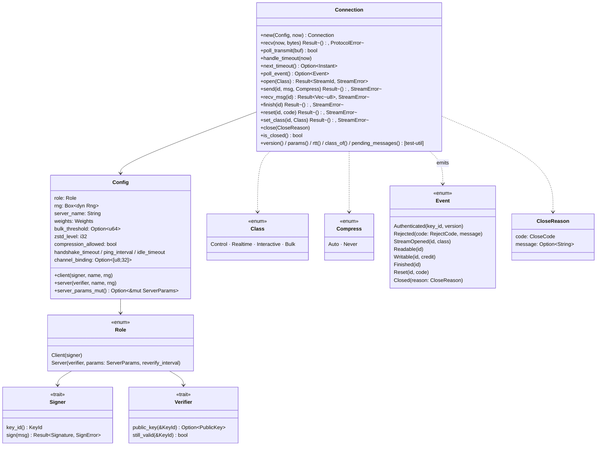

Vocabulary, one name per concept:

| Concept | Name |
|---|---|
| how a stream is scheduled | `Class` |
| whether one message may be compressed | `Compress` |
| why a connection closed (API, event, GOAWAY payload) | `CloseReason` / `CloseCode` |
| why a handshake was refused (REJECT payload) | `RejectCode` |
| why a stream was aborted | `u32` code in `reset` / `Event::Reset` |
| what the server announces | `ServerParams` (config) → `Params` (wire) |

### 2.2 Module graph

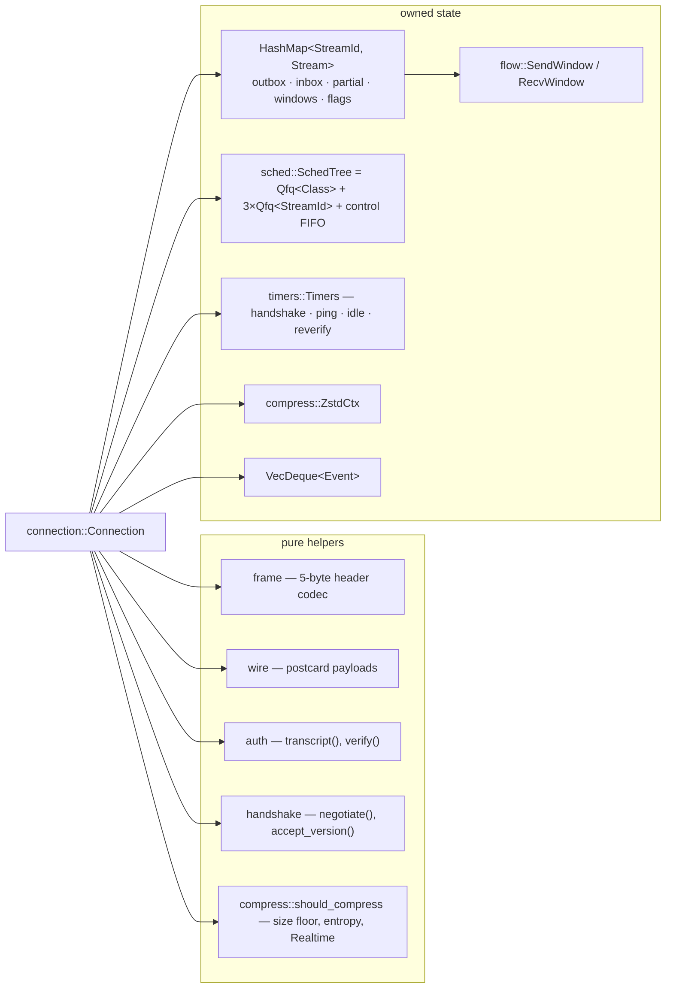

Enforced inside the crate: `#![forbid(clippy::disallowed_methods)]` +
`clippy.toml` ban `Instant::now`, `SystemTime::now` and RNG calls. Time
enters only as `now`; randomness only via `Config::rng`. Keys never enter:
the crate sees a `KeyId` and a `Signature`.

### 2.3 What each public call touches

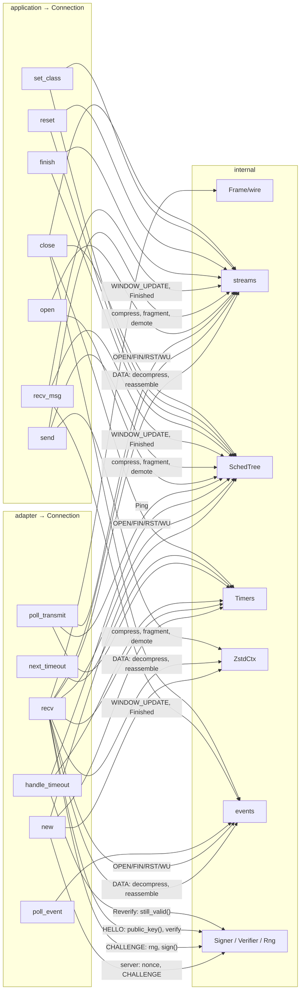

Only `new`, `recv` and `handle_timeout` reach the adapter-supplied traits.
Every stream method goes through one `ready()` check: `Closed` after
close, `NotAuthenticated` before WELCOME.

### 2.4 Handshake

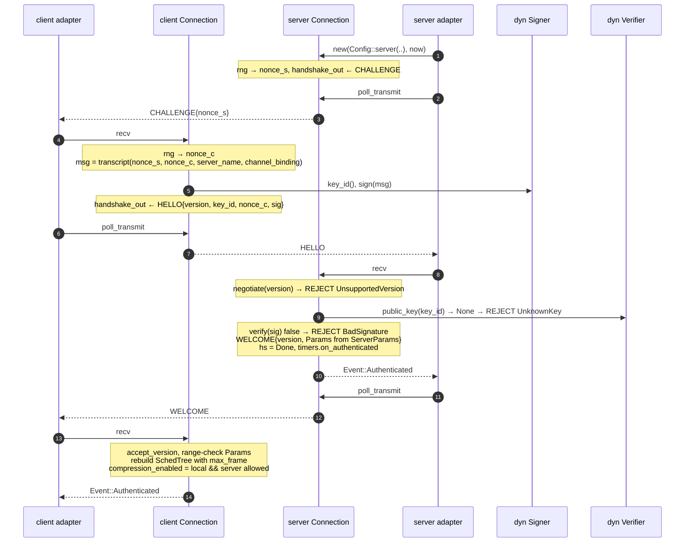

REJECT closes the server side without GOAWAY and yields
`Event::Rejected` then `Event::Closed` on the client.

### 2.5 One message, end to end

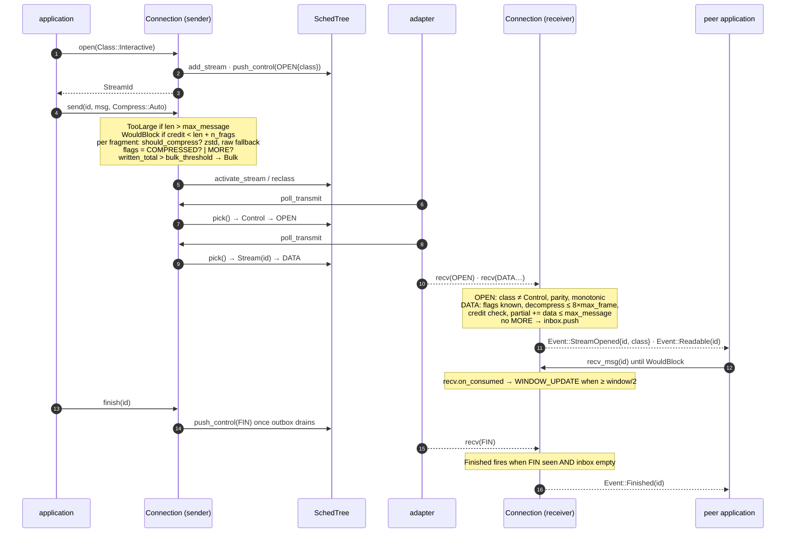

Stream release is automatic: once both halves are closed, FIN queued,
outbox empty and `Finished` delivered, the stream is forgotten. No extra
read is required.

### 2.6 Timers

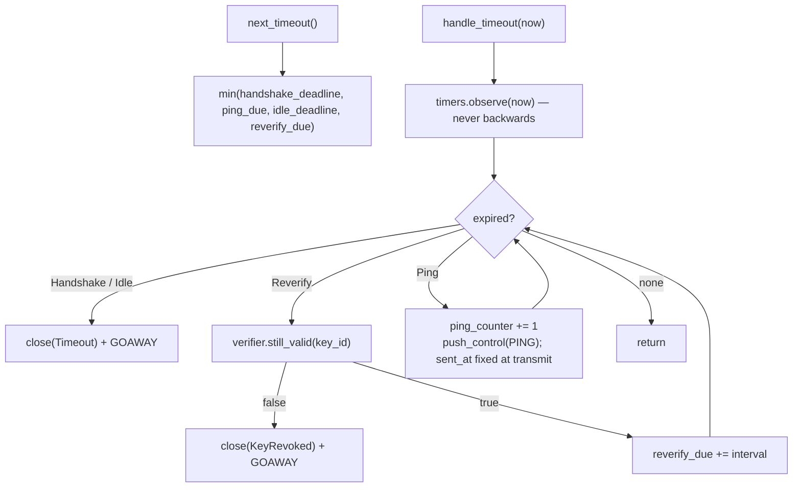

## 3. `weaver-proto`

A schema crate plus the single place that translates HTTP into mux
vocabulary. No state, no I/O, no mux driving.

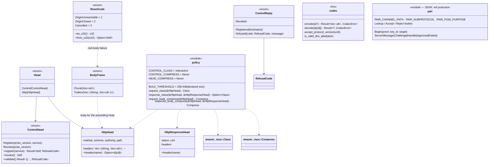

Stream conventions (all in `weaver-proto` docs, enforced by the handlers).
After the head, every message is a `BodyFrame` decoded from stream state —
never from a tag; `Trailers` is the optional final frame before FIN. A
mid-body origin failure travels as a typed `ResetCode` on the mux reset
frame. **The control stream is the registration lease**: a service is
registered exactly as long as the control stream that registered it is
open. The client drops a service by finishing that stream; the relay
unregisters it on `Finished`/`Reset`, and unregisters everything on
`Closed`. There is no `Unregister` message because the stream lifecycle
already expresses it.

The control stream also carries one **one-shot** head, `Revoke`: a client
authenticated by a device key is entitled to withdraw that very key, so
`weave unpair` opens a control stream, sends `Revoke`, and the relay deletes
the machine — its key, services and hostnames — then answers
`ControlReply::Revoked`. A `KeyRevoked` close is an equivalent confirmation;
the relay closes the connection after the reply. Pairing has its own
transport and does not touch the mux control plane: `weaver-proto::pair` is
fairly ordinary JSON (the pairing channel is a plain WebSocket on the admin
host, and the browser API is JSON already), so it is the one schema module
that is *not* postcard.

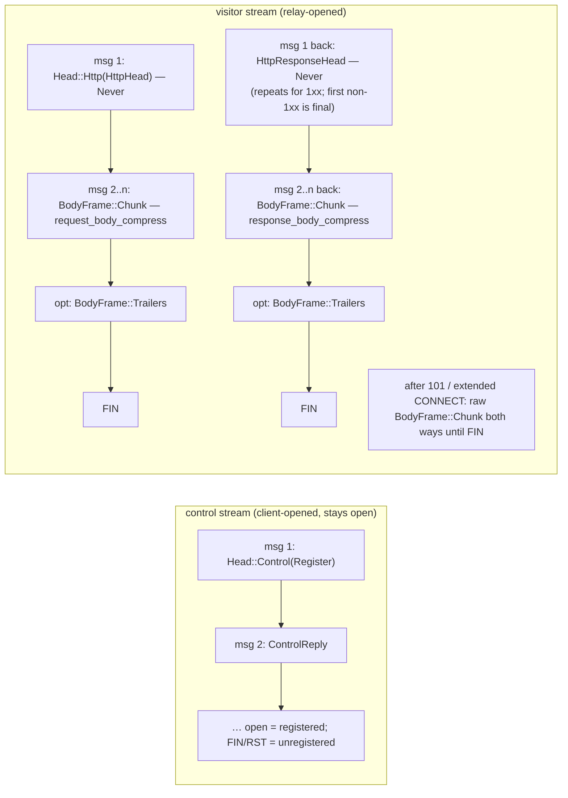

Policy rules, in the order they apply:

| Decision | Rule |
|---|---|
| `request_class` | `Upgrade` or `Accept: text/event-stream` → `Realtime`; declared `Content-Length` > 256 KiB → `Bulk`; else `Interactive` (mux demotes after `bulk_threshold` sent bytes) |
| `response_class` | request already realtime → keep; response `text/event-stream` → `Realtime`; declared length > 256 KiB → `Bulk` |
| heads | always `Never` (cookies, tokens, CSRF secrets) |
| bodies | `Never` if realtime, `Content-Encoding` set, MIME pre-compressed, or request carries `Authorization`/`Cookie` and the response is `text/html` / `application/json` / `xhtml` (BREACH); else `Auto` |

## 4. `weaver-tokio`

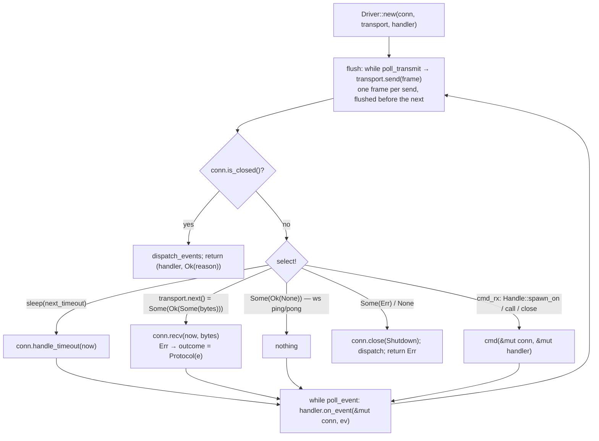

Public surface: `Driver`, `Handle<H>` (`spawn_on`, `call`, `close`),
`StreamHandler::on_event`, `DriverError`, `Transport`, `WsTransport`,
`SystemRng`, `set_tcp_notsent_lowat`. It re-exports nothing from
`weaver-mux`; binaries import mux types from `weaver_mux` directly.

## 5. Binaries: the two `StreamHandler`s

### 5.1 Relay (`weaver-server/src/tunnel/connection.rs`)

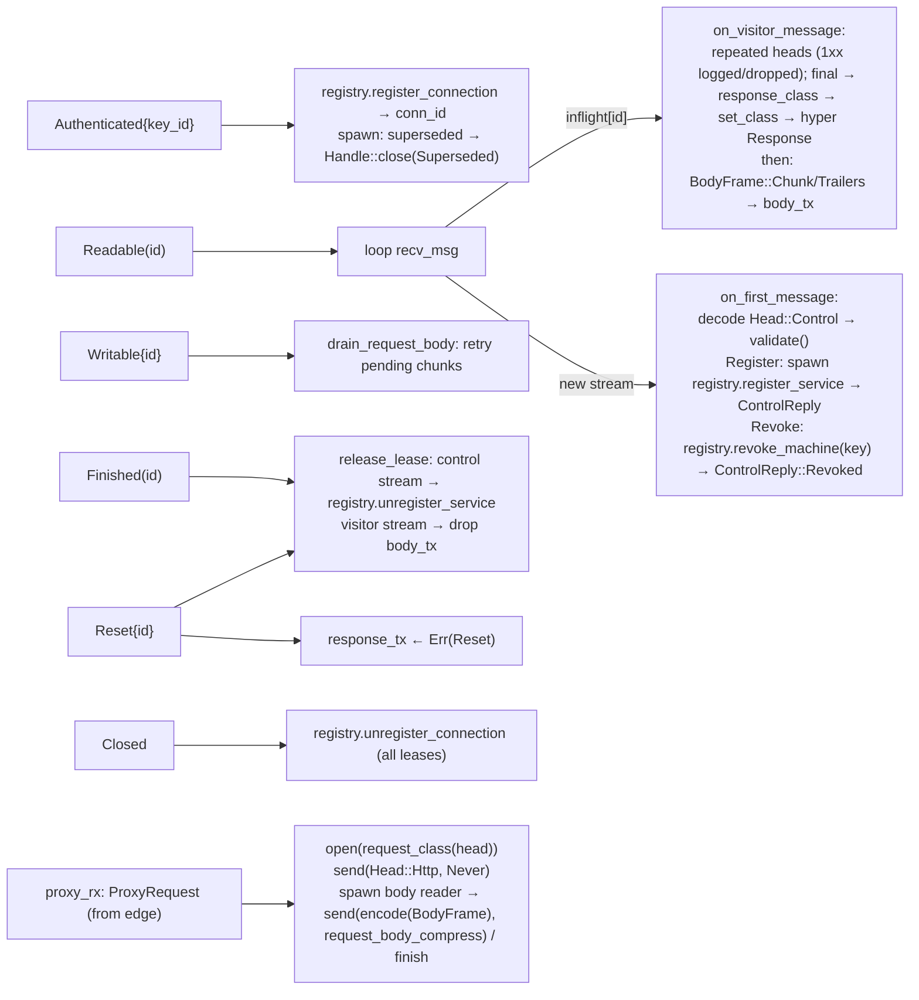

### 5.2 Client (`weave/src/start.rs`)

One `weave start <service>=<target>…` invocation registers every service on
a single connection: one control stream per service, one `Driver`. Each
visitor stream is answered by an origin task (`weave/src/proxy.rs`) that
drives one outbound hyper request through the per-target pool
(`weave/src/pool.rs`).

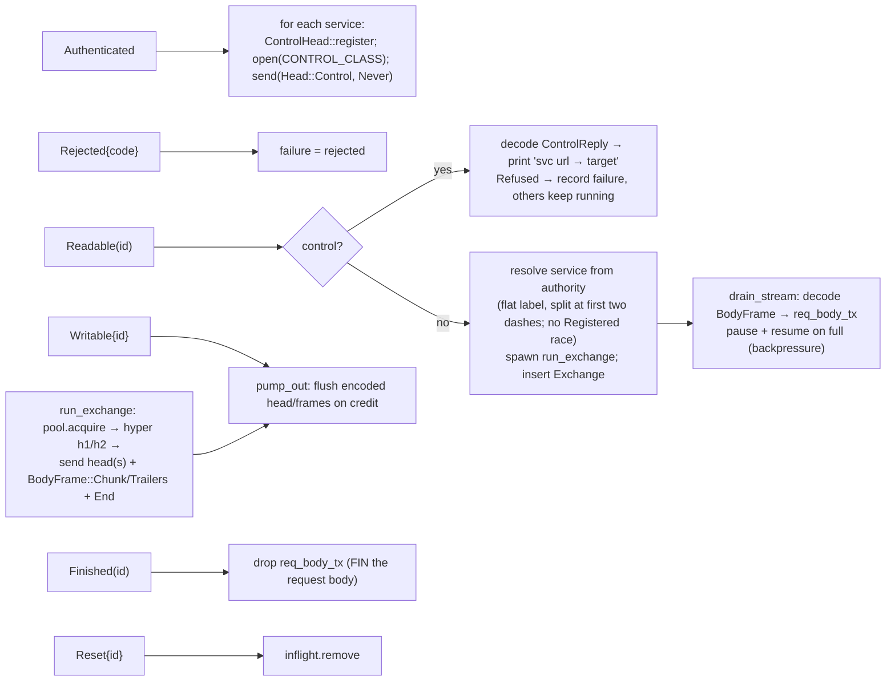

The connection is dialled to the paired relay's **admin host** — the only
address the client knows — at `/_weaver/connect`, and the host it presents is
the mux handshake server name (ADR 0011). The public URL of each service
comes from `ControlReply::Registered { hostname }`; the client prints it and
never derives or caches it. Resolving an incoming visitor stream still falls
back to the flat label (the reply may not have been seen yet), but the relay
is the authority for what that label is.

### 5.3 A visitor request through every layer

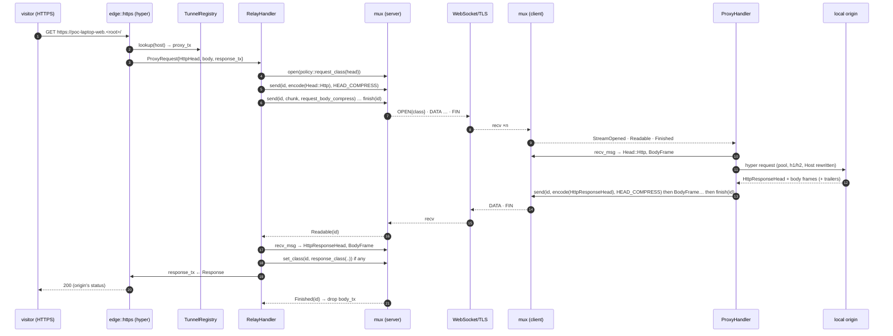

## 6. Pairing and the machine identity model

### 6.1 Commands and the client's own state (`crates/weave`)

`weave` is a small stateful agent, not a one-shot tunnel command:

| Command | Effect |
|---|---|
| `weave pair <admin-host> [--machine ID] [--min-key-security L] [--allow-below-floor]` | enrol this machine's device key with a relay, with browser approval |
| `weave start <service>=<target>… [--server HOST]` | register services on a paired relay and proxy to their origins |
| `weave unpair [<admin-host>]` | revoke this machine on the relay, then forget it locally |
| `weave relays` / `weave relays default <admin-host>` | list paired relays / choose the default |

Its durable state is a SeaORM-managed SQLite database
(`crates/weave/src/store/`) in the platform's per-user data directory
(`directories`; overridable with `WEAVE_DATA_DIR`), file `weave.db`. It holds
the fingerprint of the machine's one device key (a single `device` row, so a
later command resumes that key instead of having tpmd mint another) and **one
`relay` row per pairing** — the admin host it dials, the machine id the relay
assigned, and the device-key fingerprint authorised there — plus which relay is
the default (a partial unique index allows at most
one; the first pairing becomes it). It deliberately holds no relay-owned
state: no hostname, no tunnel root, no service address (ADR 0011).

The device key never leaves **tpmd**, the local key agent. `weave` stores only
its `p256:<hex>` fingerprint and signs by asking the agent over async IPC —
which is why the mux's `Signer::sign` is asynchronous even though the mux
itself stays sans-IO. `--min-key-security` (`file`/`keyring`/`sealed`/
`hardware`, default `sealed`) is a floor; provisioning below it needs
`--allow-below-floor` or an interactive yes. `weave start` only ever *resumes*
the key the relay authorised, so a vanished key is an error the user resolves
by pairing again, never a silent new identity.

### 6.2 The pairing flow

Pairing uses two transports, neither of them the mux:

- the **pairing channel** — a plain JSON WebSocket the CLI opens to the admin
  host at `/api/account/pair/channel` (subprotocol `weaver-pair-v1`). The relay
  speaks first with a signed ALTCHA proof-of-work challenge (purpose `pair`);
  the CLI answers with exactly one `Begin { proof, key_id, target }`; the relay
  answers with a `Handle` and then exactly one outcome.
- the **browser API** — `POST /api/account/pair/{lookup,accept,reject}`,
  behind a session (and origin + CSRF for accept/reject).

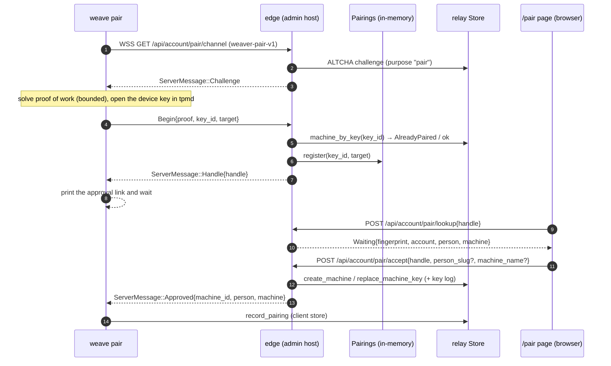

The **handle** is a capability: 32 random bytes, lowercase hex, single use,
carried only in the link's fragment (never the query) and in JSON bodies — so
it cannot reach an access log or a `Referer`. The pending pairing is
**in-memory only** (`account::pairing::Pairings`): it lives exactly as long as
the CLI's channel, so there is nothing to expire or sweep, and a relay restart
simply ends it. Above it sit the usual abuse controls: the proof of work, the
`account-pair` request budget, a 16 KiB message cap and a 60 s `Begin`
timeout.

`target` selects the machine: `New { hostname }` creates a machine (the relay
proposes a slug from the raw hostname and the person slug from the account
name, and the person may edit a proposed name); `Existing { machine_id }`
moves a machine whose key was lost onto this key — its id, name, services and
hostnames stay, only the key changes. `weave pair` chooses between them from
its own store: a known relay under a different key means the old key is gone.

### 6.3 Identity model and schema

- One account owns exactly **one person** (`person.account_id` unique).
- A machine belongs to one person and holds exactly **one key**
  (`machine.key_id` unique). The key alone identifies the machine — and
  therefore the person, the account, and every hostname derived from them.
  There is no `machine_key` table any more; attaching a key to an existing
  machine **overwrites `key_id` in place**.
- Nothing that authenticates a key reads history: `StoreIdentityResolver`
  resolves `machine.key_id` and nothing else, and the mux `Verifier` and the
  registry's authorization source are the same resolver, so they cannot
  disagree. `machine_key_log` is a **write-only audit trail** (one row per key,
  opened when attached, closed on replace or revoke; deliberately no foreign
  keys, so it outlives the machine). The account sweep drops rows retired
  longer ago than `account.key_log_retention_days` (default 365); rows of
  current keys are never dropped.
- Pairing is the **only** enrolment path; there is no implicit creation at
  authentication time.
- Revocation is bilateral: `weave unpair` authenticates with the very key it
  revokes and the relay deletes the machine — cascading to its services and
  hostnames, and closing its key log row as revoked. The name is freed, so a
  later pairing may propose it again. The client forgets the relay only once
  the relay has replied `Revoked`; there is no one-sided unpair.

The relay's schema is now a **single squashed migration**, `m0001_init`,
which creates the final schema directly (relay config and ACME accounts; the
account plane; `person`/`machine`/`machine_key_log`; services and hostnames;
certificates and challenges; usage; abuse buckets and ALTCHA). There is no
backward compatibility and no incremental history: the live relay's database
was rebuilt rather than migrated.

### 6.4 Tunnel addressing

The mux WebSocket `/_weaver/connect` is served on the **tunnel root and the
admin host**. A client only ever knows the admin host it paired with, so it
dials that; the host it presents (parsed from the request and lowercased)
becomes the mux handshake `server_name` on both ends, binding the transcript to
the name the client actually dialled. The relay reports each registered
service's public hostname in `ControlReply::Registered { hostname }`, so the
client learns its address rather than constructing or caching it.

Admin hosts are normalised once — lowercased, trailing dot stripped, a default
`:443` dropped, a pasted `https://host/` accepted — before being stored and
before being dialled; the normalised value is what TCP, SNI, the `Host` header
and the transcript all use. Because the admin host is the transcript name and
the admin certificate's name, renaming it means re-pairing.

## 7. Boundary checklist

What to verify when touching a boundary. Each row is currently true.

| Boundary | Invariant | Enforced by |
|---|---|---|
| mux ⟂ time / randomness | only `now` parameters and `Config::rng` | clippy `disallowed_methods`, `#![forbid]` |
| mux ⟂ keys | `Signer`/`Verifier` traits; mux sees `KeyId` + `Signature` | `Role` enum carries exactly one of them |
| mux ⟂ content | OPEN carries only `Class`; DATA is opaque bytes + flags | `wire.rs` has no MIME/HTTP types; `compress` is content-agnostic |
| mux ⟂ transport | one `recv` = one message; one `poll_transmit` = one frame; no length prefix | `Driver::flush`; `frame.rs` header has no length |
| proto → mux | uses `Class` and `Compress` only, never `Connection` | `weaver-proto/Cargo.toml` + `policy.rs` imports |
| proto ⟂ identity | `Head`/`HttpHead` carry no keys or hostnames; the `pair` module carries a `KeyId` and a raw hostname on purpose, as the enrolment schema | `identity` lives in `weave` and `weaver-server` |
| tokio ⟂ schema | `Driver` is generic in `H: StreamHandler`; never decodes | `weaver-tokio` does not depend on `weaver-proto` |
| one name per concept | `Class`, `Compress`, `CloseReason`, `RejectCode`, reset `u32` | ADR 0005 table |
| uniform stream API | every stream method → `ready()`; accessors → `Option` | `Connection::ready`, `class_of`, `pending_messages` |
| no hidden code | every `pub` item has a production caller, or is a test/fuzz hook under `wire`/`testing` | ADR 0005 |
| schema validation at the schema | service name and proto version checked by `ControlHead::register` / `validate` on both ends | `control.rs`; registry does not re-validate |
| identity ⟂ key history | authentication reads `machine.key_id` only; `machine_key_log` is write-only | `StoreIdentityResolver`, migration indexes, ADR 0010 |
| client ⟂ relay-assigned addressing | the client store holds only the admin host, machine id and key fingerprint | client store, ADR 0011 |
| pending pairing ⟂ persistence | a pending pairing is in memory only, live exactly as long as the CLI's channel | `account::pairing::Pairings`; no table |
| unauthenticated pairing ⟂ abuse | proof of work (ALTCHA purpose `pair`), the `account-pair` budget, a 16 KiB message cap and a 60 s `Begin` timeout | `account/pairing.rs`, edge routing |
